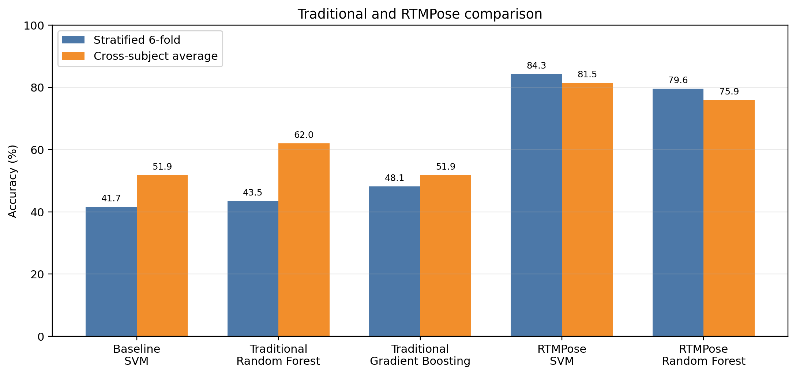

# Fine-Grained Hand Pose Classification

This ELG5163 project compares a traditional silhouette-based computer-vision
pipeline with a pre-trained RTMPose Hands keypoint pipeline for three fine-grained
thumb poses: abduction, adduction, and opposition.

## Main results

The experiments use 108 still images from two participants, with front, 45-degree,
and 90-degree views and three occlusion conditions.

| Method | Stratified 6-fold | Cross-subject average | 90-degree holdout |
|---|---:|---:|---:|
| Baseline traditional SVM | 41.67% | 51.85% | 30.56% |
| Enhanced traditional Random Forest | 43.52% | **62.04%** | 44.44% |
| Enhanced traditional gradient boosting | **48.15%** | 51.85% | 38.89% |
| RTMPose keypoints + SVM | **84.26%** | **81.48%** | 47.22% |
| RTMPose keypoints + gradient boosting | 83.33% | 70.37% | **61.11%** |

The traditional method remains lightweight and interpretable, but learned hand
keypoints separate the thumb poses substantially better. Side views and
hand-on-hand occlusion remain the most difficult conditions.



## Methods

### Traditional pipeline

1. Segment skin in YCrCb/HSV colour spaces and clean the mask morphologically.
2. Extract contour, convex-hull, Hu-moment, convexity-defect, palm-radius,
   skeleton, width-profile, and HOG features.
3. Mirror right hands into a common orientation and normalize silhouettes.
4. Compare SVM, Random Forest, histogram gradient boosting, and HOG-SVM models.

### AI keypoint pipeline

1. Detect the target hand and estimate 21 landmarks with the official RTMDet and
   RTMPose-m Hand5 models through `rtmlib` and ONNX Runtime.
2. Translate landmarks to the wrist, align the palm direction, normalize by palm
   size, and mirror right hands.
3. Use normalized landmark coordinates, confidence scores, thumb joint angles,
   and thumb-to-fingertip distances as model features.
4. Compare SVM, Random Forest, histogram gradient boosting, and a shallow tree.

## Repository layout

```text
ai_method/                  RTMPose extraction and evaluation
traditional_method/         segmentation, feature extraction, and classifiers
report_assets/              comparison chart and report-generation scripts
labels.csv                  dataset manifest and experimental metadata
*/results/                  saved numeric results and non-sensitive figures
```

## Setup and execution

```bash
python3 -m venv .venv
source .venv/bin/activate
pip install -r requirements.txt

python traditional_method/segment_hands.py
python traditional_method/extract_features.py
python traditional_method/enhanced_traditional.py
python ai_method/run_rtmpose_comparison.py
```

The RTMPose script downloads the official pre-trained checkpoints on first use.
Both main evaluation scripts use fixed random seeds.

## Dataset privacy

The participant photographs, keypoint-overlay photographs, masks, backups, and
documents containing participant imagery are intentionally excluded from this
public repository. To reproduce the experiments, place an authorized copy of the
dataset in the paths referenced by `labels.csv`. Do not publish participant data
without appropriate consent.

## License

The code is released under the [MIT License](LICENSE). Pre-trained RTMPose models
and third-party dependencies retain their respective licenses.
